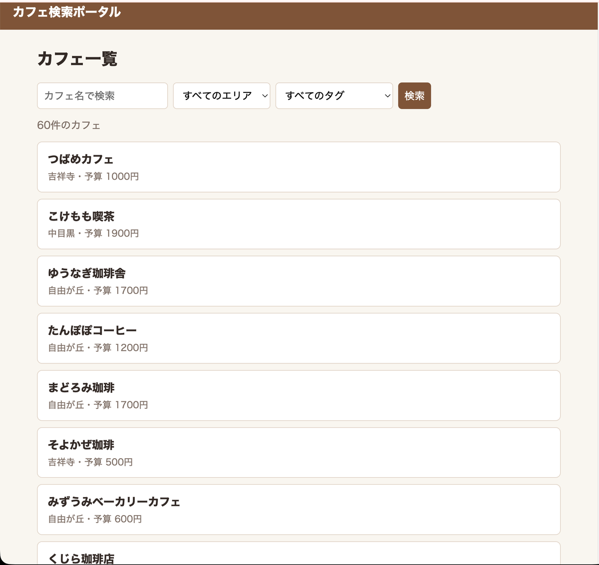
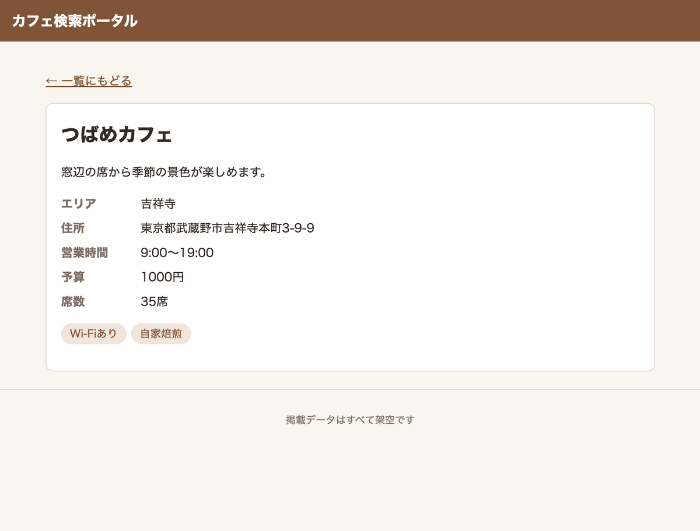
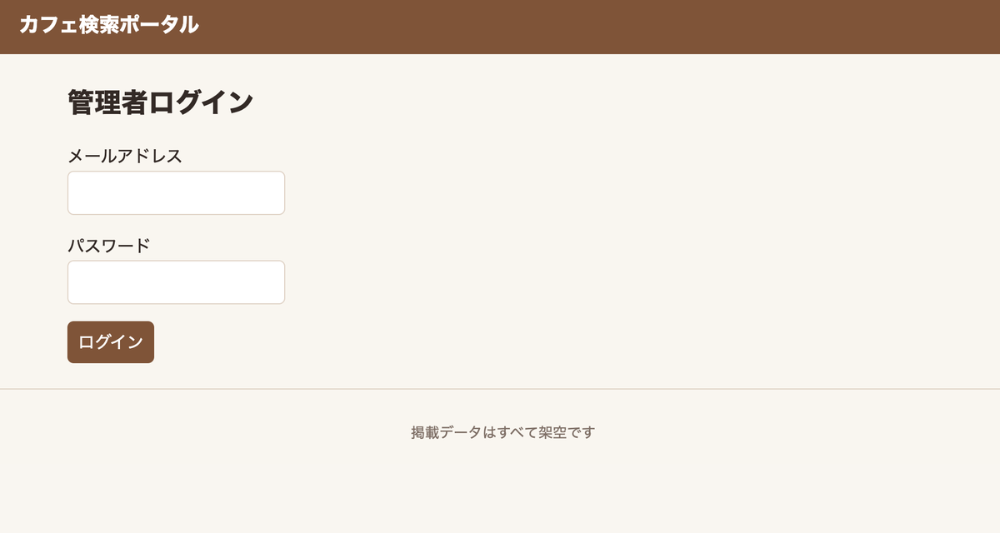
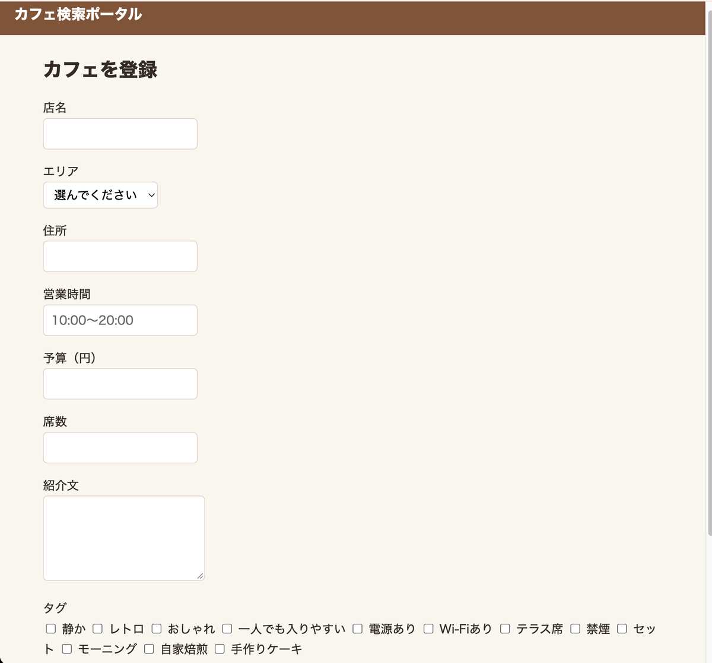

# カフェ検索ポータル

個人経営のカフェ（大手チェーンを除く）を、名前・エリア・タグで探せる検索サイトです。
PHP / Laravel の学習と、ポートフォリオのために作りました。

> 掲載しているお店のデータは、すべて架空のものです。

## 画面

| お店の一覧 | お店の詳細 |
| --- | --- |
|  |  |

| 管理者ログイン | 管理画面（カフェの登録） |
| --- | --- |
|  |  |

## できること

### 利用者向け
- カフェの一覧（1ページ10件のページ送り、件数の表示）
- カフェの詳細（エリア・住所・営業時間・予算・席数・紹介文・タグ）
- 検索・絞り込み（カフェ名・エリア・タグ。組み合わせも可能）

### 管理者向け
- ログイン・ログアウト（スターターキットを使わず、自分で作成）
- カフェの登録・編集・削除（タグの付け外しも可能）
- ログインしていない人は、管理画面に入れない

## 使った技術

| 分類 | 内容 |
| --- | --- |
| 言語 | PHP 8.5 |
| フレームワーク | Laravel 13 |
| データベース | MySQL 8.4 |
| 開発環境 | Docker（Laravel Sail） |
| 画面 | Blade、CSS |
| その他 | Git / GitHub、Laravel Pint（コード整形） |

## データベースの設計

| テーブル | 内容 |
| --- | --- |
| `areas` | エリア（下北沢・渋谷・自由が丘・吉祥寺・中目黒） |
| `tags` | タグ（雰囲気・設備・メニューの3種類、12個） |
| `cafes` | カフェ（エリアに属する） |
| `cafe_tag` | カフェとタグをつなぐ表（多対多） |
| `users` | 管理者 |

- カフェ と エリア：多対1（`belongsTo` / `hasMany`）
- カフェ と タグ：多対多（`belongsToMany`）

## 工夫したところ

- 検索条件（名前・エリア・タグ）を組み合わせても動くように、入力がある条件だけ絞り込みを足す形にしました
- ページ送りをしても、検索条件が消えないようにしました（`withQueryString`）
- 一覧でエリアをまとめて読み込み、データベースへの問い合わせを減らしました（`with('area')`）
- 登録と編集で同じ入力欄を使い回せるよう、部品（`_form.blade.php`）に分けました
- ダミーデータは、エリアと住所が合うように作りました

## 動かし方

Docker Desktop が必要です。

```bash
git clone https://github.com/yamadata-works/cafe-portal.git
cd cafe-portal
cp .env.example .env
```

`.env` のデータベースの設定を、次のようにします。

```
DB_CONNECTION=mysql
DB_HOST=mysql
DB_PORT=3306
DB_DATABASE=laravel
DB_USERNAME=sail
DB_PASSWORD=password
```

```bash
docker run --rm -u "$(id -u):$(id -g)" -v "$(pwd):/var/www/html" -w /var/www/html \
    laravelsail/php84-composer:latest composer install --ignore-platform-reqs
./vendor/bin/sail up -d
./vendor/bin/sail artisan key:generate
./vendor/bin/sail artisan migrate --seed
```

ブラウザで http://localhost/cafes を開きます。

### 管理画面（ローカルでの試用）

- 住所：http://localhost/login
- メール：`admin@example.com`
- パスワード：`password`

## 今後やりたいこと

- 自動テストの追加（検索とログインから）
- 入力エラーのメッセージを日本語にする
- お店の写真の登録
- 予算や営業時間での絞り込み
